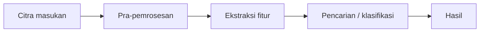

# Capstone PCD — <judul proyek Anda>

**Nama / NIM:** … · **Studi kasus:** … (masalah nyata dari tempat kerja Anda, data rekaan atau milik sendiri)

## Tahap 1 (UTS)

- Latar masalah dan mengapa pengolahan citra membantu (maks. 1 halaman)
- Diagram alur pipeline (blok `mermaid` di bawah tampil otomatis di GitHub)
- Minimal 20 citra contoh di `galeri/` dan hasil awal `pipeline.py`



## Tahap 2 (UAS)

- Aplikasi berjalan di Hugging Face Spaces: **tautan:** …
- Perbandingan minimal dua jenis fitur dengan presisi@k (tabel)
- Video demo ≤ 5 menit: **tautan:** …

## Menjalankan

```bash
pip install -r requirements.txt
python -m pytest -q        # tes pipeline
python app.py              # buka http://127.0.0.1:7860
```
